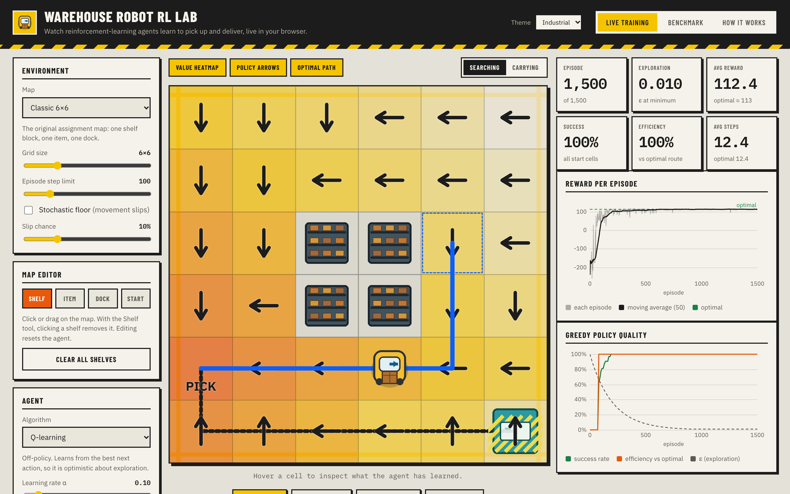
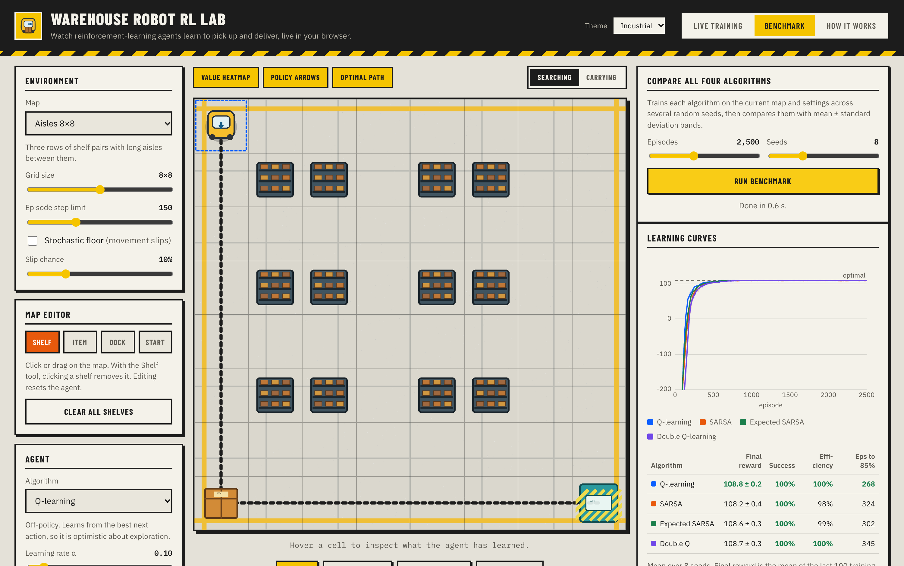
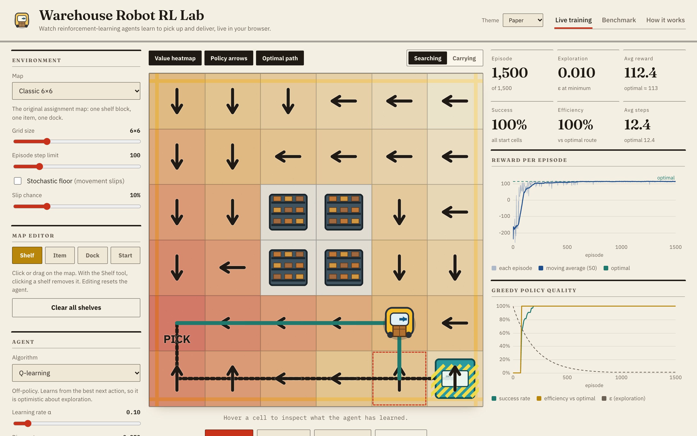

# Warehouse Robot RL Lab

An interactive reinforcement-learning lab that runs entirely in the browser. A robot has to find an item, pick it up, carry it to a dock and drop it, around shelves. Four tabular agents learn the task **live** while you watch, and you can edit the map, tune the hyperparameters and benchmark the algorithms against each other and against the exact optimal route.



## What you can do

- **Watch learning happen.** Reward curves, success rate and exploration update as the agent trains. A heatmap shows the best Q-value in every cell, and arrows show the greedy policy.
- **Compare algorithms.** Q-learning, SARSA, Expected SARSA and Double Q-learning, each with adjustable learning rate, discount and exploration decay.
- **Edit the world.** Click or drag to place shelves, move the item, dock and start cell, resize the grid (4x4 to 12x12) and switch on a stochastic floor where movement can slip.
- **Judge against optimal.** An exact planner computes the shortest route from every cell, so the app reports *success* (share of start cells that deliver) and *efficiency* (optimal steps / actual steps) and can draw the optimal path.
- **Benchmark with statistics.** Train all four algorithms across several seeds in one click and compare learning curves (mean +/- std) and a results table.



## Themes

Two built-in looks, switchable from the header (your choice is remembered): **Industrial**, a warehouse-console style, and **Paper**, a quieter lab-notebook style.




## Maps

| Map | Size | Notes |
| --- | --- | --- |
| Classic | 6x6 | One shelf block, one item, one dock |
| Open floor | 6x6 | No shelves, a sanity check |
| Aisles | 8x8 | Three rows of shelf pairs |
| Serpentine maze | 8x8 | One winding route, sparse reward, long horizon |

With the default seed, Q-learning solves the maze from every start cell (47.2 average steps, matching the optimum) after 6,000 episodes.

## Environment

State is `(x, y, carrying)`. Actions are up, down, left, right, pick and drop.

| Event | Reward |
| --- | --- |
| Successful delivery (ends the episode) | +100 |
| Pickup | +25 |
| Every step | -1 |
| Bumping a shelf (extra) | -20 |

Episodes truncate at a step limit (default 100). In stochastic mode a movement action slips and leaves the robot in place with a configurable probability (default 10%); pick and drop never slip.

## Run it

Requires Node 20+.

```bash
npm install
npm run dev      # http://localhost:5173
npm test         # unit tests
npm run build    # static site in dist/
```

The build uses relative paths, so `dist/` can be hosted from any sub-path. A GitHub Pages workflow is included in `.github/workflows/deploy.yml`.

## How it is tested

- **Environment rules**: step, wall and shelf bumps, pickup and drop conditions, truncation, slip frequency, start cells.
- **Planner**: hand-computed distances, and the optimal policy achieves return `125 - steps` in the simulator.
- **Agents**: all four algorithms solve the classic map from every start cell, results are reproducible for a fixed seed, and every preset is solvable and learnable.
- **Parity with the original environment**: `tests/original_trace.json` records 425 steps from the original Python (Gymnasium) implementation, including a full delivery, a shelf bump and wall bumps. The TypeScript port replays the same actions and must produce identical positions, rewards and termination flags.

## Project layout

```
src/
  env.ts        environment dynamics (one pure transition function shared by sim and planner)
  planner.ts    exact shortest-path planner used as the optimal baseline
  agents.ts     Q-learning, SARSA, Expected SARSA, Double Q-learning
  evaluate.ts   greedy evaluation, replay rollouts, multi-seed benchmark
  presets.ts    ready-made maps
  view.ts       canvas renderer (sprites, heatmap, policy arrows, paths)
  themes.css    the two themes (variables only)
  charts.ts     small dependency-free chart renderer
  main.ts       UI wiring and the training loop
tests/          vitest suites
scripts/        script that records traces from the original Python environment
```

There are no runtime dependencies: Vite and TypeScript for the build, Vitest for tests. Fonts (Barlow Condensed, Fraunces, IBM Plex Sans and Mono, all under the SIL Open Font License) are self-hosted in `src/fonts/`, so the site makes no third-party requests. `scripts/fetch_fonts.py` regenerates them.

## Limitations

- The agents are tabular, so they only suit small grids. Scaling up needs function approximation (for example DQN).
- Benchmarks use one fixed hyperparameter setting per run. No automatic tuning.
- A single robot, a single item and a fixed dock per map.